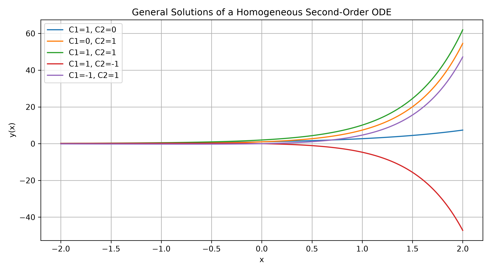
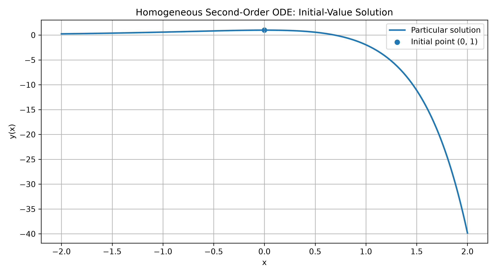

# Symbolic Solutions of Differential Equations Using Python

## Overview

This folder contains symbolic solutions of ordinary differential equations (ODEs) using Python's **SymPy** library.

The projects demonstrate how computer algebra systems can solve first-order and second-order differential equations, determine general and particular solutions, apply initial conditions, and verify analytical results symbolically.

## Projects

### 1. First-Order Differential Equations

**File:** `first_order_ode.py`

Solves the first-order linear differential equation:

\[
y'+2y=e^x.
\]

The program:

- Defines the differential equation symbolically.
- Computes its general solution using `sympy.dsolve()`.
- Verifies the solution by substitution.
- Applies an initial condition to determine the integration constant.
- Visualizes several members of the general solution and the particular solution.

### 2. Nonhomogeneous Second-Order Differential Equations

**File:** `nonhomogeneous_ode.py`

Solves the nonhomogeneous differential equation:

\[
y''-3y'+2y=e^x.
\]

The program:

- Determines the general solution.
- Verifies the solution symbolically.
- Applies two initial conditions.
- Determines the integration constants.
- Verifies the resulting particular solution.
- Visualizes general and particular solutions.

### 3. Homogeneous Second-Order Differential Equations

**File:** `second_order_ode.py`

Solves the homogeneous differential equation:

\[
y''-3y'+2y=0.
\]

The program:

- Constructs and solves the characteristic equation.
- Determines the characteristic roots.
- Computes the general solution using SymPy.
- Verifies the solution symbolically.
- Applies initial conditions.
- Determines the integration constants.
- Verifies the particular solution and initial conditions.
- Visualizes the general and particular solutions.

For the initial conditions

\[
y(0)=1,\qquad y'(0)=0,
\]

the resulting particular solution is

\[
\boxed{y(x)=2e^x-e^{2x}}.
\]

#### Generated Visualizations

The program generates two plots, which are saved in the repository's `images/` directory.

**General solution**



**Particular solution**



## Mathematical Methods

The projects cover:

- Symbolic differentiation.
- First-order linear differential equations.
- Homogeneous and nonhomogeneous second-order ODEs.
- Characteristic equations and characteristic roots.
- General and particular solutions.
- Initial-value problems.
- Symbolic verification of analytical solutions.
- Numerical evaluation and graphical visualization.

## Python Libraries

- **SymPy:** Symbolic mathematics, differentiation, equation solving, and analytical ODE solutions.
- **NumPy:** Numerical evaluation of symbolic expressions.
- **Matplotlib:** Visualization of mathematical solutions.

## Installation

Install the required libraries:

```bash
pip install sympy numpy matplotlib
```

Alternatively, install all repository dependencies:

```bash
pip install -r requirements.txt
```

## Running the Programs

Run the following commands from the repository root directory:

**First-order ODE:**

```bash
python differential_equations/symbolic/first_order_ode.py
```

**Nonhomogeneous second-order ODE:**

```bash
python differential_equations/symbolic/nonhomogeneous_ode.py
```

**Homogeneous second-order ODE:**

```bash
python differential_equations/symbolic/second_order_ode.py
```

Each program displays symbolic mathematical results and generates plots when executed.

## Learning Outcomes

These projects demonstrate how to:

1. Use SymPy to solve ordinary differential equations analytically.
2. Construct differential equations using symbolic expressions.
3. Determine general and particular solutions.
4. Solve initial-value problems.
5. Verify analytical solutions by symbolic substitution.
6. Analyze characteristic equations and their roots.
7. Combine symbolic mathematics with numerical computation.
8. Visualize families of differential equation solutions.

## Author

**Hesham Moustafa**

Assistant Professor of Mathematics  
Fahd bin Sultan University, Tabuk, Saudi Arabia

Research interests include differential equations, numerical analysis, computational mathematics, and special functions.

GitHub: [hesham123456creator](https://github.com/hesham123456creator)

Repository: [Mathematics-with-Python](https://github.com/hesham123456creator/Mathematics-with-Python)
