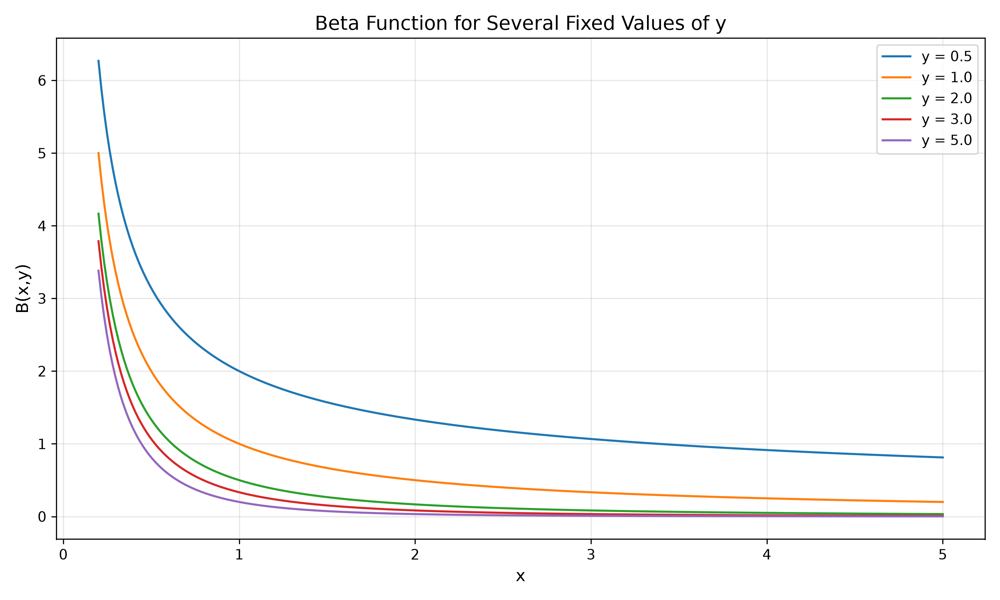
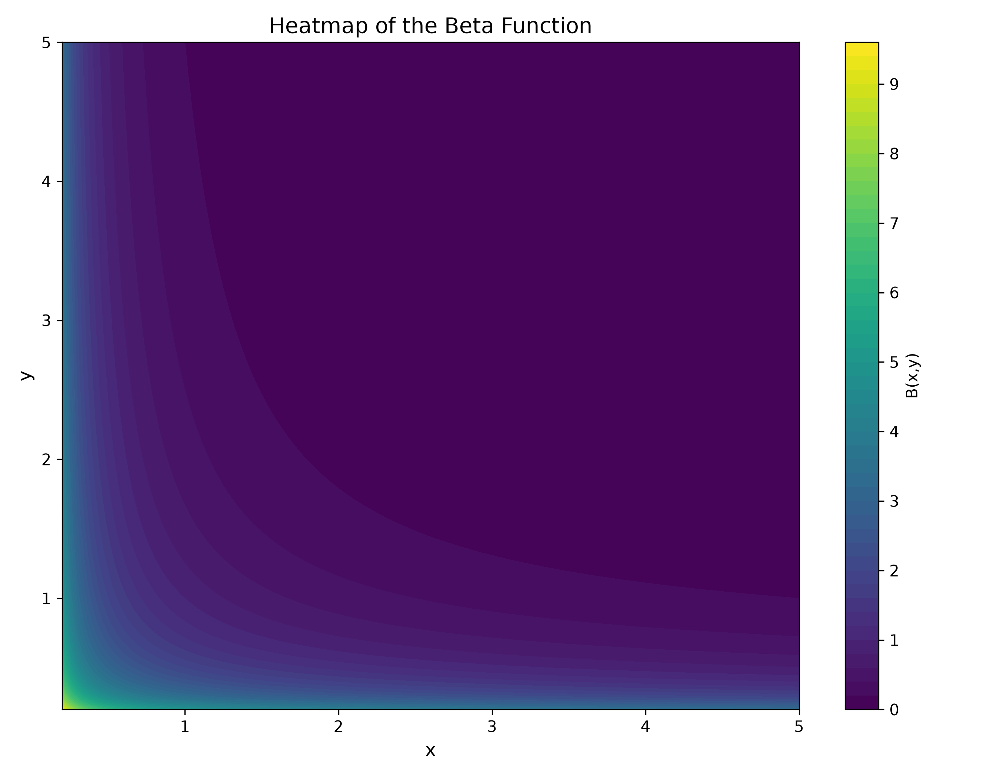
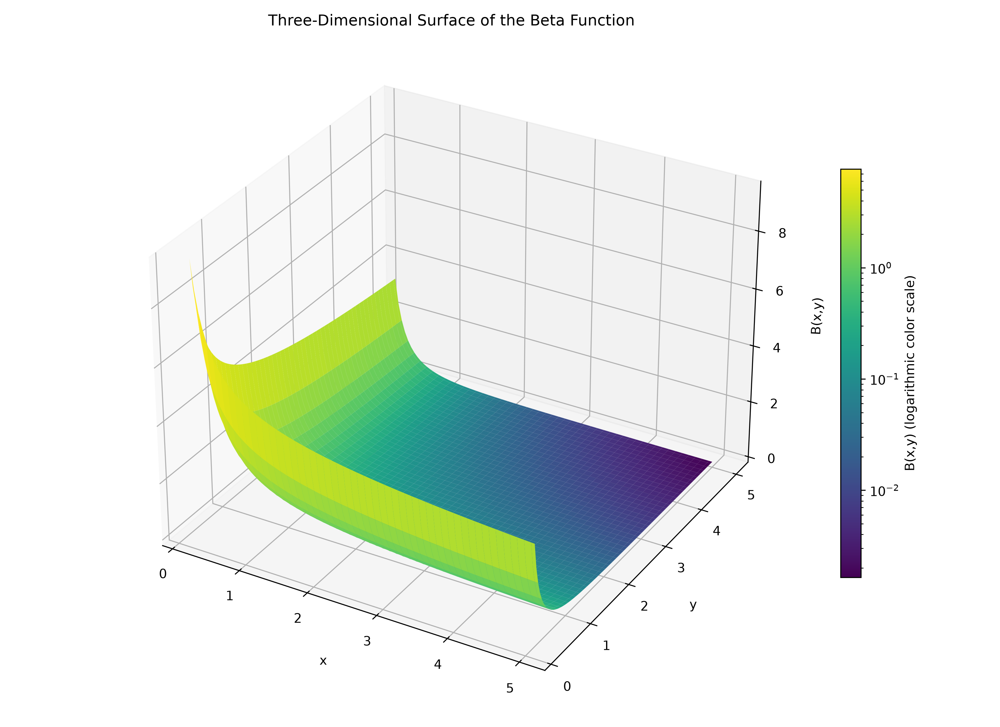

# Beta Function — Numerical and Graphical Study

## 1. Introduction

The Beta function is an important special function that appears in mathematical analysis, probability theory, statistics, and mathematical physics.

For positive real numbers \(x\) and \(y\), it is defined by

\[
B(x,y)=\int_0^1 t^{x-1}(1-t)^{y-1}\,dt.
\]

This project explores the fundamental properties of the Beta function using Python, numerical computation, and graphical visualization.

## 2. Mathematical Properties

The project investigates the following properties.

### 2.1 Symmetry Property

\[
B(x,y)=B(y,x).
\]

### 2.2 Recurrence Relations

\[
B(x+1,y)=\frac{x}{x+y}B(x,y),
\]

\[
B(x,y+1)=\frac{y}{x+y}B(x,y).
\]

### 2.3 Relation with the Gamma Function

\[
B(x,y)=\frac{\Gamma(x)\Gamma(y)}{\Gamma(x+y)}.
\]

### 2.4 Special Values

\[
B(x,1)=\frac{1}{x},
\qquad
B(1,y)=\frac{1}{y}.
\]

For positive integers \(m,n\),

\[
B(m,n)=
\frac{(m-1)!(n-1)!}{(m+n-1)!}.
\]

## 3. Numerical Implementation

The Python program uses:

- NumPy for numerical arrays and computations.
- SciPy for the Beta and Gamma functions and numerical integration.
- Matplotlib for graphical visualization.
- Python's `math` module for factorial calculations.

The program includes:

1. Numerical evaluation of the Beta function.
2. Verification of its integral representation.
3. Verification of the symmetry property.
4. Verification of both recurrence relations.
5. Verification of the Beta–Gamma identity.
6. Verification of special values and the integer formula.

## 4. Graphical Visualization

Three graphical representations are generated.

### 4.1 Beta Function Curves

The behavior of \(B(x,y)\) is illustrated for several fixed values of \(y\).



### 4.2 Two-Dimensional Heatmap

A heatmap illustrates the variation of \(B(x,y)\) over the domain

\[
0.2\leq x,y\leq 5.
\]



### 4.3 Three-Dimensional Surface

The three-dimensional surface represents

\[
z=B(x,y).
\]



## 5. Numerical Accuracy Comparison

Three independent approaches are compared:

1. SciPy's Beta function.
2. The Gamma-function quotient.
3. Numerical integration of the defining integral.

The numerical experiments show excellent agreement between the three methods for the selected test values.

The maximum absolute errors observed were approximately:

- Gamma-function formula: \(2.78\times10^{-17}\).
- Numerical integration: \(1.41\times10^{-11}\).

These results demonstrate the accuracy of the numerical computations for the tested parameters.

## 6. Requirements

The project requires Python 3 and the following libraries:

```bash
pip install numpy scipy matplotlib
```

## 7. How to Run

Navigate to the project directory:

```bash
cd special_functions/beta_function
```

Run the program:

```bash
python beta_function.py
```

The program displays the numerical verification results and generates the following figures:

- `beta_function_curves.png`
- `beta_function_heatmap.png`
- `beta_function_3d_surface.png`

## 8. Project Structure

```text
beta_function/
│
├── beta_function.py
├── README.md
│
├── beta_function_curves.png
├── beta_function_heatmap.png
└── beta_function_3d_surface.png
```

## 9. Conclusion

This project provides a computational study of the classical Beta function.

Its fundamental identities and special values are verified numerically, while graphical representations illustrate its behavior over a two-dimensional domain.

The project demonstrates how Python can be used as a practical tool for studying special functions and their mathematical properties.

## 10. Author

**Hesham Moustafa**

Assistant Professor of Mathematics

GitHub: [Mathematics-with-Python](https://github.com/hesham123456creator/Mathematics-with-Python)
