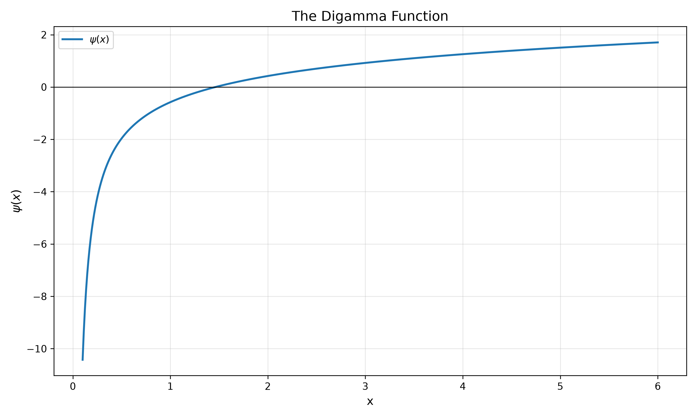
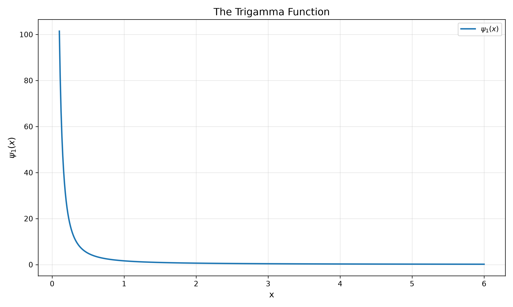
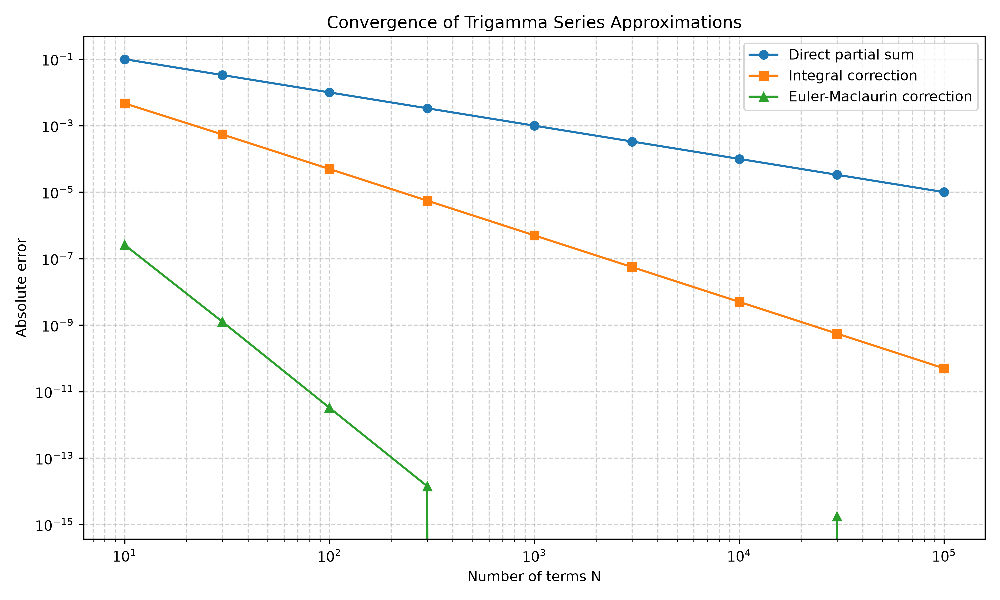

# Digamma and Trigamma Functions

## 1. Introduction

This project explores the numerical evaluation and analytical properties of the Digamma and Trigamma functions using Python.

The main objectives are to:
- Evaluate the Digamma and Trigamma functions numerically.
- Verify recurrence relations and special values.
- Investigate the complete monotonicity of the Trigamma function.
- Study the series representation of Trigamma derivatives.
- Compare numerical approximation methods using integral and Euler–Maclaurin corrections.

## 2. Mathematical Background

### 2.1 Digamma Function

The Digamma function is defined as the logarithmic derivative of the Gamma function:

\[
\psi(x)=\frac{\Gamma'(x)}{\Gamma(x)}.
\]

Its recurrence relation is

\[
\psi(x+1)=\psi(x)+\frac{1}{x}.
\]

Important special values include

\[
\psi(1)=-\gamma,
\]

and

\[
\psi\left(\frac12\right)=-\gamma-2\ln 2,
\]

where \(\gamma\) denotes the Euler–Mascheroni constant.

### 2.2 Trigamma Function

The Trigamma function is the first derivative of the Digamma function:

\[
\psi_1(x)=\psi'(x).
\]

Its recurrence relation is

\[
\psi_1(x+1)=\psi_1(x)-\frac{1}{x^2}.
\]

The series representation is

\[
\psi_1(x)=\sum_{k=0}^{\infty}\frac{1}{(x+k)^2},
\qquad x>0.
\]

Some important special values are

\[
\psi_1(1)=\frac{\pi^2}{6},
\qquad
\psi_1\left(\frac12\right)=\frac{\pi^2}{2}.
\]

## 3. Complete Monotonicity

The Trigamma function is completely monotonic on \((0,\infty)\).

In particular,

\[
(-1)^n\psi_1^{(n)}(x)>0,
\qquad x>0,\quad n=0,1,2,\ldots
\]

Using its series representation, we obtain

\[
(-1)^n\psi_1^{(n)}(x)
=
(n+1)!\sum_{k=0}^{\infty}
\frac{1}{(x+k)^{n+2}}>0.
\]

The Python program numerically investigates this property for derivative orders from zero to four.

## 4. Numerical Approximation of the Series

Consider the series

\[
S_n(x)=(n+1)!\sum_{k=0}^{\infty}
\frac{1}{(x+k)^{n+2}}.
\]

Three numerical approximation methods are investigated.

### Method 1: Direct Partial Sum

\[
S_n(x)\approx
(n+1)!\sum_{k=0}^{N-1}
\frac{1}{(x+k)^{n+2}}.
\]

### Method 2: Integral-Tail Correction

The omitted tail is approximated using

\[
R_N\approx
\frac{1}{(n+1)(x+N)^{n+1}}.
\]

### Method 3: Euler–Maclaurin Correction

Writing \(p=n+2\) and \(a=x+N\), the tail approximation is

\[
R_N\approx
\frac{a^{1-p}}{p-1}
+\frac{1}{2}a^{-p}
+\frac{p}{12}a^{-p-1}.
\]

The resulting approximation is

\[
S_n(x)\approx(n+1)!
\left[
\sum_{k=0}^{N-1}\frac{1}{(x+k)^p}
+R_N
\right].
\]

This correction significantly improves numerical accuracy.

## 5. Numerical Experiments

The program performs the following experiments:

1. Numerical evaluation of the Digamma function.
2. Verification of the Digamma recurrence relation.
3. Verification of Digamma special values.
4. Numerical evaluation and visualization of the Trigamma function.
5. Verification of the Trigamma recurrence relation.
6. Numerical investigation of complete monotonicity.
7. Comparison of series approximations with SciPy.
8. Comparison of direct, integral-corrected, and Euler–Maclaurin approximations.
9. Investigation of numerical error convergence.

## 6. Figures

### Digamma Function



### Trigamma Function



### Series Convergence Comparison



The convergence experiment demonstrates the significant improvement obtained using the Euler–Maclaurin correction.

For the Trigamma function at \(x=0.5\), the direct truncation error decreases approximately as \(N^{-1}\), while the integral-corrected error decreases approximately as \(N^{-2}\). The Euler–Maclaurin correction through the \(B_2\) term has a theoretical remainder of order \(N^{-5}\).

## 7. Technologies

- Python
- NumPy
- SciPy
- Matplotlib
- SymPy

## 8. Project Structure

```text
digamma_function/
│
├── digamma_function.py
├── README.md
│
├── digamma_function_plot.png
├── trigamma_function_plot.png
└── trigamma_series_convergence.png
```

## 9. Running the Project

Activate the Python virtual environment and execute:

```bash
python digamma_function.py
```

The program generates the numerical results and saves the figures.

## 10. Conclusion

This project provides a computational study of the Digamma and Trigamma functions, combining numerical evaluation, recurrence relations, special values, and complete monotonicity.

It also illustrates how integral and Euler–Maclaurin corrections can substantially improve the numerical approximation of infinite series.

The project forms part of a broader exploration of special functions and their analytical and numerical properties.
