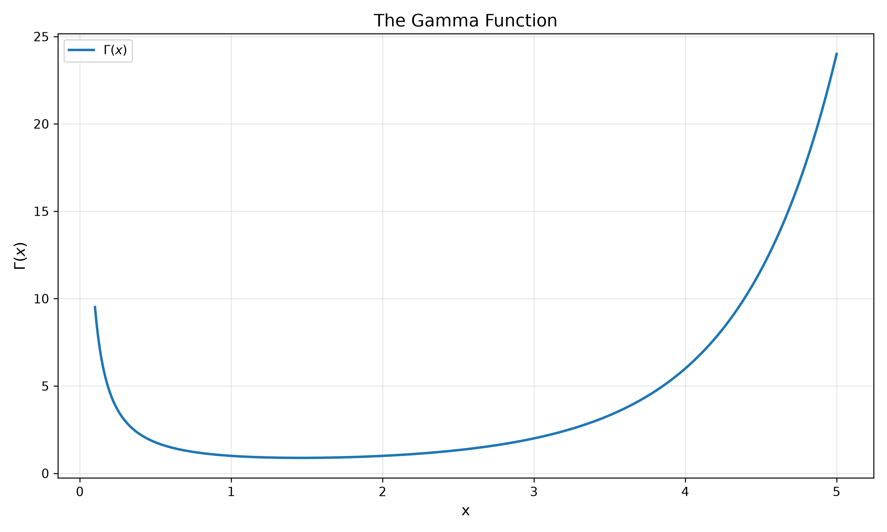
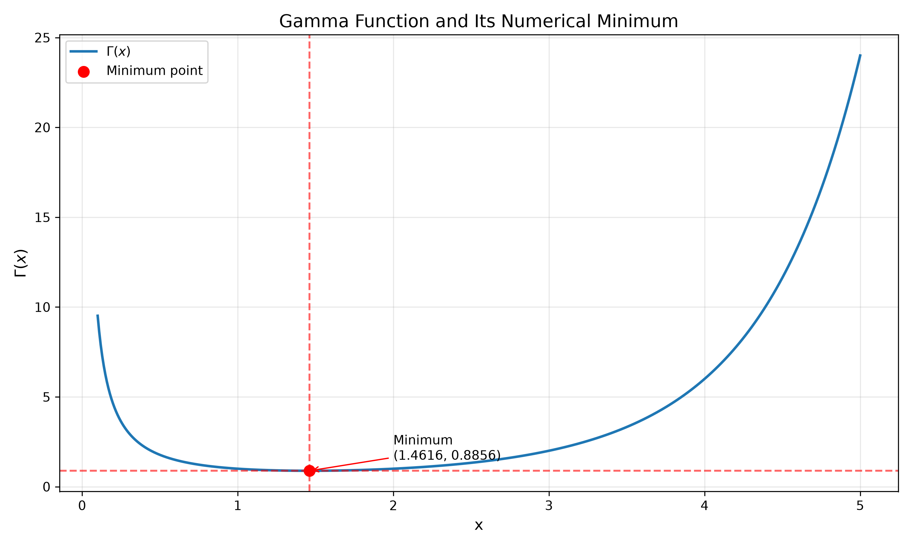
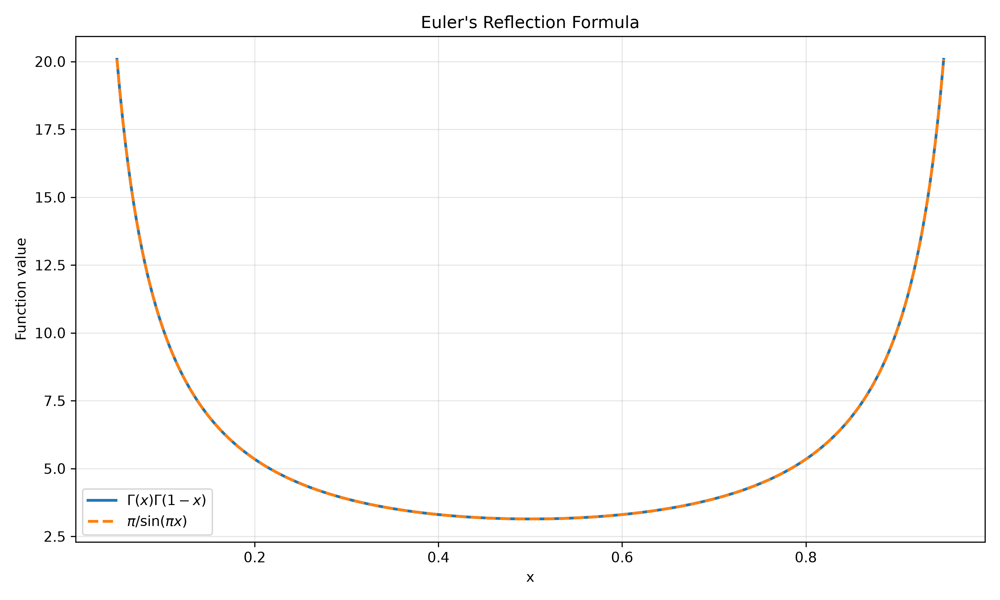
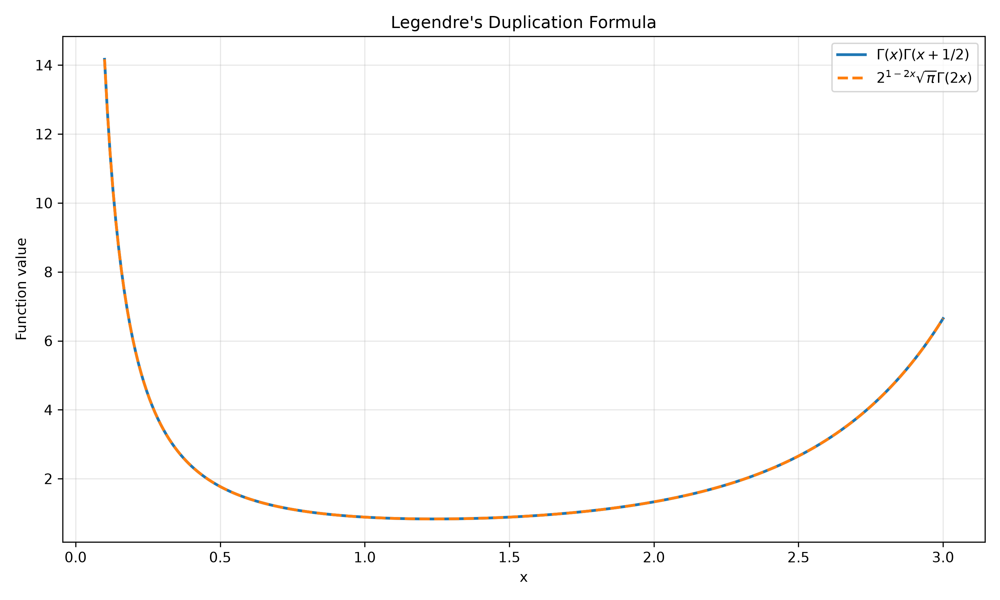
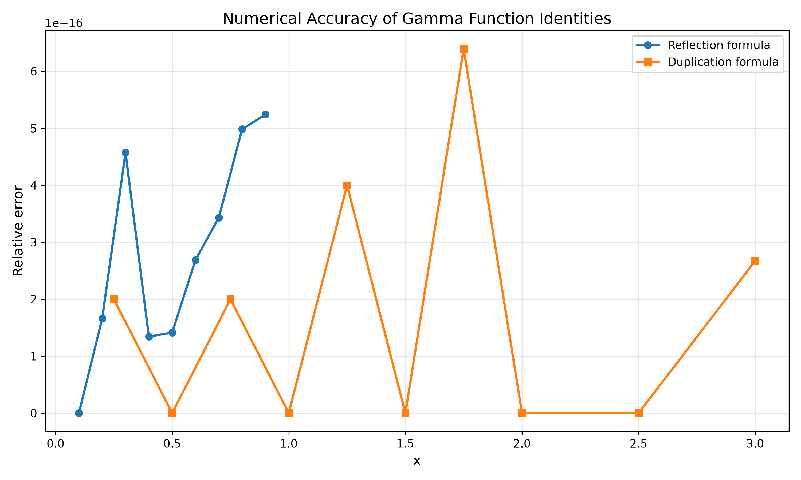

# Gamma Function: Mathematical Properties and Computation

## 1. Overview

This project explores the Gamma function using Python. It combines mathematical properties, numerical computation, verification of important identities, error analysis, and graphical visualization.

The Gamma function is a fundamental special function that extends the factorial function to non-integer arguments.

## 2. Mathematical Definition

For \(x>0\), the Gamma function is defined by

\[
\Gamma(x)=\int_0^\infty t^{x-1}e^{-t}\,dt.
\]

## 3. Fundamental Properties

### 3.1 Recurrence Relation

\[
\Gamma(x+1)=x\Gamma(x).
\]

### 3.2 Factorial Relation

For positive integers \(n\),

\[
\Gamma(n)=(n-1)!.
\]

### 3.3 Special Value

\[
\Gamma\left(\frac12\right)=\sqrt{\pi}.
\]

### 3.4 Minimum on the Positive Real Axis

The Gamma function has a unique global minimum for positive real arguments, approximately at

\[
x_{\min}\approx 1.461632.
\]

The corresponding minimum value is

\[
\Gamma(x_{\min})\approx 0.885603.
\]

### 3.5 Euler's Reflection Formula

For \(0<x<1\),

\[
\Gamma(x)\Gamma(1-x)
=\frac{\pi}{\sin(\pi x)}.
\]

### 3.6 Legendre's Duplication Formula

For \(x>0\),

\[
\Gamma(x)\Gamma\left(x+\frac12\right)
=
2^{1-2x}\sqrt{\pi}\Gamma(2x).
\]

## 4. Python Libraries

The implementation uses:

- NumPy
- SciPy
- SymPy
- Matplotlib
- Math (Python standard library)

## 5. Numerical Experiments

The Python program performs:

1. Numerical evaluation of the Gamma function.
2. Verification of the recurrence relation.
3. Verification of the factorial relation.
4. Verification of the special value at \(x=1/2\).
5. Graphical visualization of the Gamma function.
6. Numerical determination of its minimum using SciPy optimization.
7. Numerical verification of Euler's reflection formula.
8. Numerical verification of Legendre's duplication formula.
9. Absolute and relative error analysis for both identities.
10. Graphical comparison of the relative errors.

## 6. Numerical Error Analysis

The numerical accuracy of the two Gamma function identities is investigated using absolute and relative errors.

The absolute error is defined as

\[
E_{\mathrm{abs}}=|L-R|,
\]

where \(L\) and \(R\) denote the left-hand and right-hand sides of the identity.

The relative error is defined as

\[
E_{\mathrm{rel}}=\frac{|L-R|}{|R|}.
\]

### 6.1 Numerical Results

The numerical experiments produce the following maximum errors.

| Identity | Maximum absolute error | Maximum relative error |
|---|---:|---:|
| Reflection formula | \(5.33\times10^{-15}\) | \(5.24\times10^{-16}\) |
| Duplication formula | \(1.78\times10^{-15}\) | \(6.40\times10^{-16}\) |

The results demonstrate excellent numerical agreement between both sides of the identities, with errors consistent with double-precision floating-point rounding.

## 7. Visualizations

### 7.1 Gamma Function



### 7.2 Gamma Function and Its Numerical Minimum



### 7.3 Euler's Reflection Formula



### 7.4 Legendre's Duplication Formula



### 7.5 Numerical Error Comparison



## 8. Project Structure

```text
gamma_function/
├── gamma_function.py
├── gamma_function_plot.png
├── gamma_function_minimum.png
├── gamma_reflection_formula.png
├── gamma_duplication_formula.png
├── gamma_formula_error_comparison.png
└── README.md
```

## 9. How to Run

From the root directory of the repository:

```bash
python special_functions/gamma_function/gamma_function.py
```

Required libraries can be installed using:

```bash
pip install numpy scipy sympy matplotlib
```

## 10. Learning Outcomes

This project demonstrates practical skills in:

- Special functions and their mathematical properties.
- Numerical evaluation using SciPy.
- Verification of mathematical identities.
- Numerical optimization.
- Absolute and relative error analysis.
- Scientific computing with Python.
- Mathematical visualization using Matplotlib.

## Author

**Hesham Moustafa**

Assistant Professor of Mathematics
