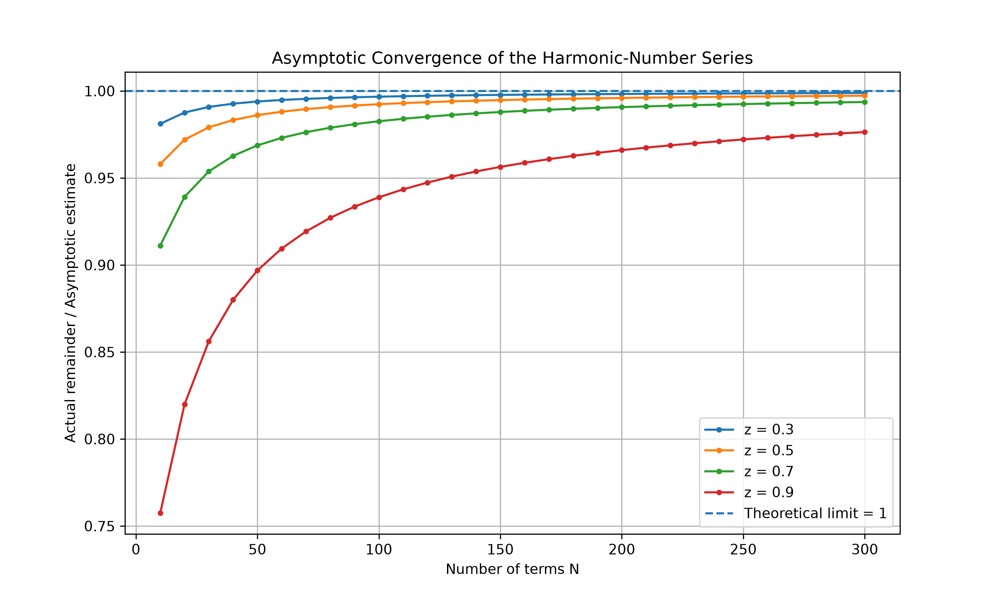
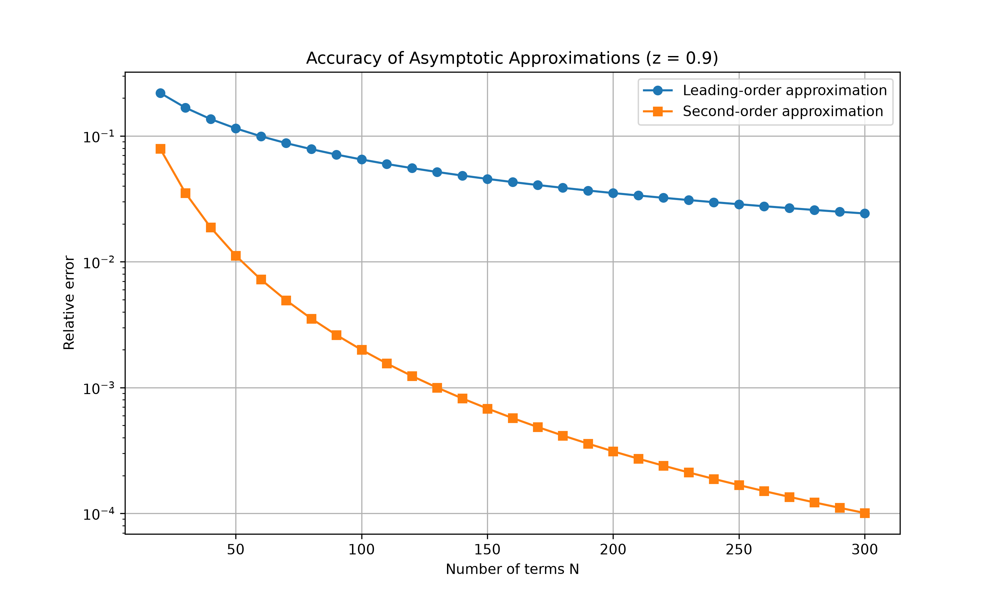
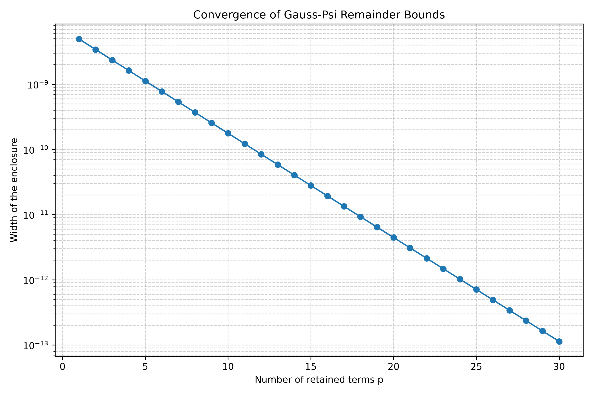
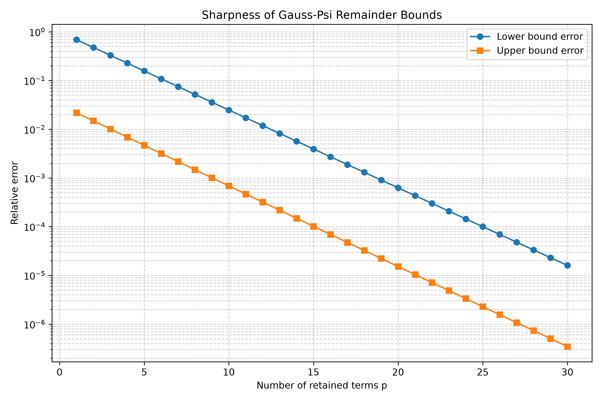

# Gauss–Psi Connection

## 1. Introduction

This project studies the parameter derivative of the Gauss hypergeometric function and its connection with the digamma function and harmonic numbers.

We consider

\[
D(z)=\left.\frac{\partial}{\partial a}
{}_2F_1(a,2;3;z)\right|_{a=1}.
\]

## 2. Digamma and Harmonic-Number Connection

The derivative of the Pochhammer symbol is given by

\[
\frac{\partial}{\partial a}(a)_n
=(a)_n[\psi(a+n)-\psi(a)],
\]

where \(\psi\) denotes the digamma function.

At \(a=1\), we use

\[
\psi(n+1)-\psi(1)=H_n,
\]

where

\[
H_n=\sum_{k=1}^{n}\frac{1}{k}
\]

is the nth harmonic number.

Consequently,

\[
D(z)=\sum_{n=1}^{\infty}
\frac{2H_n}{n+2}z^n.
\]

## 3. Closed-Form Representation

The function also admits the following logarithmic representation:

\[
D(z)=\frac{2}{z^2}
\left[
-z+\frac12\ln^2(1-z)
-(1-z)\ln(1-z)
\right],
\]

for \(0<z<1\).

## 4. Asymptotic Remainder Analysis

Define the truncation remainder by

\[
R_N(z)=\sum_{n=N+1}^{\infty}
\frac{2H_n}{n+2}z^n.
\]

The leading-order asymptotic approximation is

\[
R_N(z)\sim
\frac{2H_{N+1}}{N+3}
\frac{z^{N+1}}{1-z},
\qquad N\to\infty.
\]

The numerical investigation examines the accuracy of this approximation using high-precision arithmetic.

## 5. Second-Order Remainder Approximation

Let

\[
a_n=\frac{2H_n}{n+2},
\qquad m=N+1,
\]

and define

\[
\delta_m=\frac{a_{m+1}}{a_m}-1,
\]

\[
\varepsilon_m=
\frac{a_{m+2}-2a_{m+1}+a_m}{a_m}.
\]

A second-order approximation is investigated:

\[
R_N(z)\approx a_m z^m
\left[
\frac{1}{1-z}
+\frac{\delta_m z}{(1-z)^2}
+\frac{\varepsilon_m z^2}{(1-z)^3}
\right].
\]

Its numerical accuracy is compared with the leading-order approximation.

## 6. Numerical Implementation

The Python implementation compares:

- Numerical differentiation of the hypergeometric function.
- The harmonic-number series.
- The analytical closed form.
- Leading-order remainder approximations.
- Second-order remainder approximations.
- High-precision remainder calculations using mpmath.

High-precision arithmetic is used to avoid loss of accuracy when the truncation remainder becomes extremely small.

## 7. Numerical Results

### 7.1 Comparison of Three Representations

### 7.2 Truncation Error

### 7.3 High-Precision Asymptotic Ratio

The numerical ratio approaches 1 as \(N\) increases, supporting the leading-order asymptotic approximation.

### 7.4 Second-Order Approximation Accuracy

The second-order approximation provides improved numerical accuracy compared with the leading-order approximation in the tested cases.

## 8. Technologies

- Python
- NumPy
- SciPy
- Matplotlib
- mpmath

## 9. Research Direction

Future work will focus on:

- Rigorous asymptotic estimates for the truncation remainder.
- Explicit upper and lower bounds.
- Higher-order remainder approximations.
- Analytical inequalities involving harmonic numbers and digamma functions.
- Further applications of parameter derivatives of hypergeometric functions.

## 10. Rigorous Bounds for the Gauss-Psi Remainder

This project establishes rigorous two-sided bounds for the truncation remainder

\[
R_N(z)=\sum_{n=N+1}^{\infty}a_nz^n,
\qquad
a_n=\frac{2H_n}{n+2}.
\]

For integers \(N\geq1\), \(p\geq1\), and \(0<z<1\), we obtain

\[
L_p(N,z)<R_N(z)<U_p(N,z),
\]

where

\[
L_p(N,z)=
\sum_{k=0}^{p-1}a_{N+1+k}z^{N+1+k}
\]

and

\[
U_p(N,z)=L_p(N,z)+
\frac{a_{N+p+1}z^{N+p+1}}{1-z}.
\]

The enclosure width is

\[
U_p-L_p=
\frac{2H_{N+p+1}}{N+p+3}
\frac{z^{N+p+1}}{1-z}.
\]

### Numerical Verification

The Python program `remainder_bounds.py` verifies the bounds using high-precision arithmetic and compares different values of \(N\), \(z\), and \(p\).

### Convergence of the Remainder Bounds

The numerical results confirm that the enclosure becomes narrower as the number of retained terms increases.

## 11. Numerical Sharpness of the Remainder Bounds

To investigate the sharpness of the theoretical bounds, we compare
the actual remainder with its lower and upper estimates.

For fixed N and z, define the relative errors

\[
E_L=\frac{R_N(z)-L_p(N,z)}{R_N(z)},
\qquad
E_U=\frac{U_p(N,z)-R_N(z)}{R_N(z)}.
\]

The numerical experiment uses N = 50 and z = 0.7.

The results show that both relative errors decrease as the number
of retained terms p increases. In this example, the upper bound
provides a particularly sharp approximation.

For p = 30, the relative errors are approximately

- Lower bound: 0.00160%.
- Upper bound: 0.0000346%.

### Numerical illustration

The experiment also illustrates that the convergence of the bounds
becomes slower as z approaches 1.

These numerical observations complement the rigorous two-sided
remainder theorem established in Section 10.

## 12. A Sharper Harmonic-Number-Dependent Upper Bound

In this section, we derive an improved upper bound for the Gauss-Psi remainder by exploiting additional properties of the harmonic-number coefficients.

Recall that

\[
a_n=\frac{2H_n}{n+2},
\]

and define

\[
m=N+p+1,\qquad
C_m=H_m-\frac{m+2}{m+1}.
\]

### 12.1. A coefficient inequality

For \(m\geq 3\) and \(j\geq 0\), we have

\[
H_{m+j}
=H_m+\sum_{k=1}^{j}\frac{1}{m+k}
\leq H_m+\frac{j}{m+1}.
\]

Consequently,

\[
\begin{aligned}
a_{m+j}
&\leq
\frac{2}{m+j+2}
\left(H_m+\frac{j}{m+1}\right)\\
&=
\frac{2}{m+1}
+\frac{2C_m}{m+j+2}.
\end{aligned}
\]

Thus,

\[
\boxed{
a_{m+j}\leq
\frac{2}{m+1}
+\frac{2C_m}{m+j+2}.
}
\]

### 12.2. Improved upper bound

Define the auxiliary series

\[
S_m(z)=
\sum_{j=0}^{\infty}\frac{z^j}{m+j+2}.
\]

For \(0<z<1\), it admits the representation

\[
S_m(z)=
\frac{-\ln(1-z)-\displaystyle\sum_{k=1}^{m+1}\frac{z^k}{k}}
{z^{m+2}}.
\]

Using the coefficient inequality, we obtain the improved upper bound

\[
\boxed{
U_{\mathrm{new}}(N,z,p)
=
L_p(N,z)+2z^m
\left[
\frac{1}{(m+1)(1-z)}
+C_mS_m(z)
\right].
}
\]

### 12.3. Theorem: Strict improvement over the geometric bound

For integers \(N\geq1\), \(p\geq1\), and \(0<z<1\), let

\[
R_N(z)=\sum_{n=N+1}^{\infty}a_nz^n.
\]

Then

\[
\boxed{
L_p(N,z)<R_N(z)
<U_{\mathrm{new}}(N,z,p)
<U_{\mathrm{old}}(N,z,p),
}
\]

where the original geometric upper bound is

\[
U_{\mathrm{old}}(N,z,p)
=
L_p(N,z)+
\frac{a_mz^m}{1-z}.
\]

**Proof.**

Since \(C_m>0\) for \(m\geq3\), for every \(j\geq0\),

\[
\frac{2}{m+1}
+\frac{2C_m}{m+j+2}
\leq
\frac{2}{m+1}
+\frac{2C_m}{m+2}
=a_m.
\]

The inequality is strict for \(j\geq1\). Multiplying by \(z^j\) and summing gives

\[
\frac{1}{m+1}\frac{2}{1-z}
+2C_mS_m(z)
<
\frac{a_m}{1-z}.
\]

Combining this result with the coefficient inequality yields

\[
R_N(z)<U_{\mathrm{new}}(N,z,p)
<U_{\mathrm{old}}(N,z,p).
\]

The lower inequality \(L_p(N,z)<R_N(z)\) follows because the omitted tail consists of strictly positive terms. This completes the proof.

### 12.4. Numerical verification

The improved upper bound was implemented in `remainder_bounds.py` and compared with the original geometric upper bound.

A systematic numerical verification considered:

- \(N\in\{1,5,10,50,100\}\);
- \(p\in\{1,2,5,10,20\}\);
- \(z\in\{0.2,0.5,0.7,0.9,0.99\}\).

All 125 tested combinations satisfied

\[
L_p(N,z)<R_N(z)<U_{\mathrm{new}}(N,z,p)
<U_{\mathrm{old}}(N,z,p).
\]

The numerical tests complement the analytical proof and illustrate the improvement obtained through the harmonic-number-dependent estimate.
