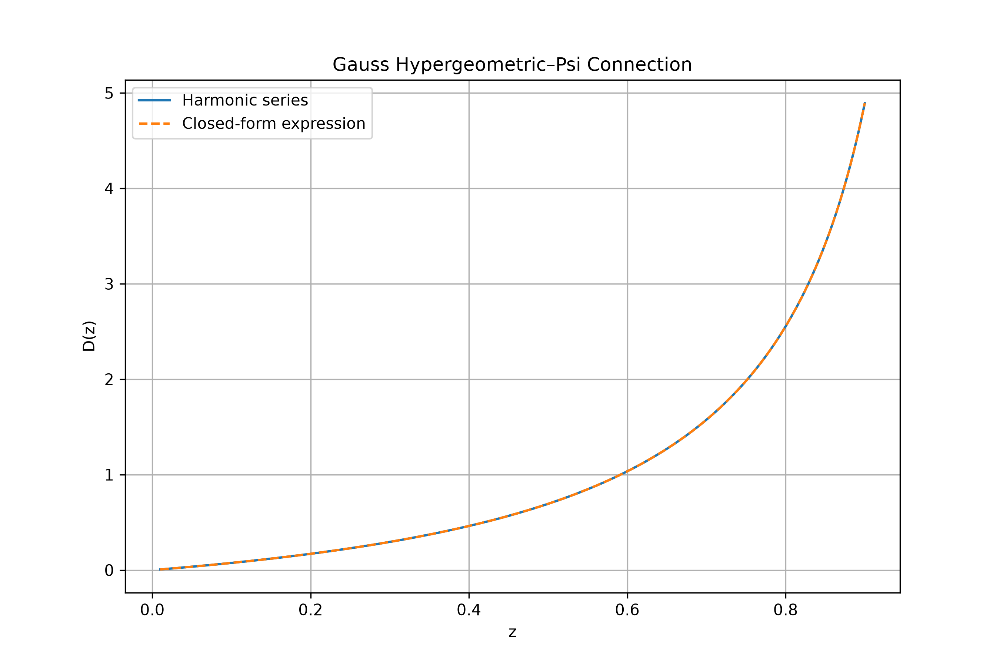
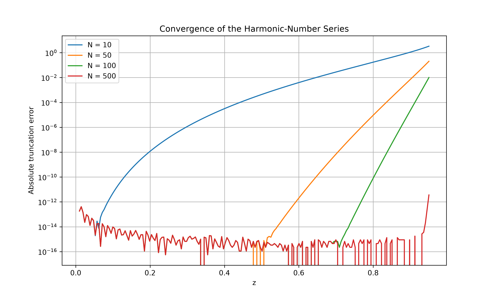

# Gauss–Psi Connection

## 1. Introduction

This project studies the parameter derivative of the Gauss hypergeometric function and its connection with the digamma function and harmonic numbers.

We consider

\[
D(z)=\left.\frac{\partial}{\partial a}
{}_2F_1(a,2;3;z)\right|_{a=1}.
\]

## 2. Digamma and Harmonic-Number Connection

The derivative of the Pochhammer symbol is given by

\[
\frac{\partial}{\partial a}(a)_n
=(a)_n[\psi(a+n)-\psi(a)],
\]

where \(\psi\) denotes the digamma function.

At \(a=1\), we use

\[
\psi(n+1)-\psi(1)=H_n,
\]

where

\[
H_n=\sum_{k=1}^{n}\frac{1}{k}
\]

is the nth harmonic number.

Consequently,

\[
D(z)=\sum_{n=1}^{\infty}
\frac{2H_n}{n+2}z^n.
\]

## 3. Closed-Form Representation

The function also admits the following logarithmic representation:

\[
D(z)=\frac{2}{z^2}
\left[
-z+\frac12\ln^2(1-z)
-(1-z)\ln(1-z)
\right],
\]

for \(0<z<1\).

## 4. Asymptotic Remainder Analysis

Define the truncation remainder by

\[
R_N(z)=\sum_{n=N+1}^{\infty}
\frac{2H_n}{n+2}z^n.
\]

The leading-order asymptotic approximation is

\[
R_N(z)\sim
\frac{2H_{N+1}}{N+3}
\frac{z^{N+1}}{1-z},
\qquad N\to\infty.
\]

The numerical investigation examines the accuracy of this approximation using high-precision arithmetic.

## 5. Second-Order Remainder Approximation

Let

\[
a_n=\frac{2H_n}{n+2},
\qquad m=N+1,
\]

and define

\[
\delta_m=\frac{a_{m+1}}{a_m}-1,
\]

\[
\varepsilon_m=
\frac{a_{m+2}-2a_{m+1}+a_m}{a_m}.
\]

A second-order approximation is investigated:

\[
R_N(z)\approx a_m z^m
\left[
\frac{1}{1-z}
+\frac{\delta_m z}{(1-z)^2}
+\frac{\varepsilon_m z^2}{(1-z)^3}
\right].
\]

Its numerical accuracy is compared with the leading-order approximation.

## 6. Numerical Implementation

The Python implementation compares:

- Numerical differentiation of the hypergeometric function.
- The harmonic-number series.
- The analytical closed form.
- Leading-order remainder approximations.
- Second-order remainder approximations.
- High-precision remainder calculations using mpmath.

High-precision arithmetic is used to avoid loss of accuracy when the truncation remainder becomes extremely small.

## 7. Numerical Results

### 7.1 Comparison of Three Representations

### 7.2 Truncation Error

### 7.3 High-Precision Asymptotic Ratio

The numerical ratio approaches 1 as \(N\) increases, supporting the leading-order asymptotic approximation.

### 7.4 Second-Order Approximation Accuracy

The second-order approximation provides improved numerical accuracy compared with the leading-order approximation in the tested cases.

## 8. Technologies

- Python
- NumPy
- SciPy
- Matplotlib
- mpmath

## 9. Research Direction

Future work will focus on:

- Rigorous asymptotic estimates for the truncation remainder.
- Explicit upper and lower bounds.
- Higher-order remainder approximations.
- Analytical inequalities involving harmonic numbers and digamma functions.
- Further applications of parameter derivatives of hypergeometric functions.
