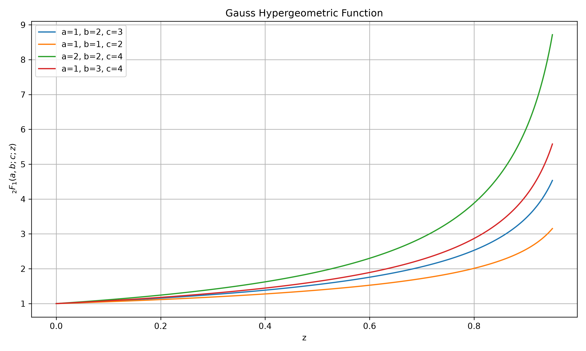
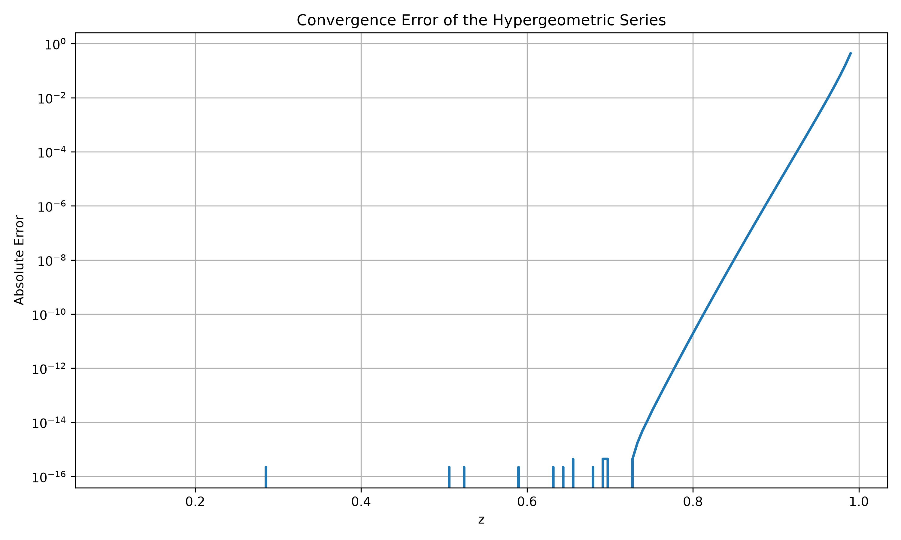

# Hypergeometric Functions with Python

## 1. Introduction

This project presents a numerical and analytical study of the Gauss hypergeometric function using Python.

The Gauss hypergeometric function is one of the most important special functions in mathematical analysis. It appears in differential equations, mathematical physics, probability theory, and many other areas.

The project explores its numerical evaluation, series representation, differential equation, transformation formulas, integral representation, special values, and convergence properties.

## 2. Mathematical Definition

The Gauss hypergeometric function is defined by the power series

\[
{}_2F_1(a,b;c;z)
=
\sum_{n=0}^{\infty}
\frac{(a)_n(b)_n}{(c)_n n!}z^n,
\]

where the Pochhammer symbol is defined by

\[
(a)_0=1,
\qquad
(a)_n=a(a+1)\cdots(a+n-1).
\]

Here, (a,b,c) are parameters and (z) is the independent variable.

The parameter (c) must not be a nonpositive integer for the standard series definition.

For generic parameters, the radius of convergence is 1.

## 3. Numerical Evaluation

The function is evaluated numerically using SciPy's `hyp2f1` function.

For the first experiment, we consider

\[
a=1,\qquad b=2,\qquad c=3.
\]

The numerical values are computed for several values of (z) in the interval ([0,1)).

## 4. Analytical Verification

For the selected parameters, the hypergeometric function admits the closed-form expression

\[
{}_2F_1(1,2;3;z)
=
\frac{2[-\ln(1-z)-z]}{z^2},
\qquad 0<z<1.
\]

The numerical results obtained using SciPy are compared with this analytical formula.

## 5. Series Representation and Convergence

For (a=1), (b=2), and (c=3), the defining series becomes

\[
{}_2F_1(1,2;3;z)
=
\sum_{n=0}^{\infty}\frac{2z^n}{n+2}.
\]

Partial sums are compared with the numerical reference values to investigate convergence.

## 6. Gauss Hypergeometric Differential Equation

The Gauss hypergeometric function satisfies the second-order differential equation

\[
z(1-z)y''
+[c-(a+b+1)z]y'
-ab y=0,
\]

where

\[
y={}_2F_1(a,b;c;z).
\]

The first and second derivatives are evaluated using the differentiation formulas:

\[
y'(z)=\frac{ab}{c}
{}_2F_1(a+1,b+1;c+1;z),
\]

\[
y''(z)=
\frac{a(a+1)b(b+1)}{c(c+1)}
{}_2F_1(a+2,b+2;c+2;z).
\]

The differential equation is verified numerically by calculating its residual.

## 7. Euler's Transformation Formula

Euler's transformation is given by

\[
{}_2F_1(a,b;c;z)
=
(1-z)^{c-a-b}
{}_2F_1(c-a,c-b;c;z).
\]

The identity is verified numerically for different parameter values.

## 8. Euler's Integral Representation

Under the conditions

\[
\operatorname{Re}(c)>\operatorname{Re}(b)>0,
\]

Euler's integral representation is

\[
{}_2F_1(a,b;c;z)
=
\frac{\Gamma(c)}
{\Gamma(b)\Gamma(c-b)}
\int_0^1
t^{b-1}(1-t)^{c-b-1}
(1-zt)^{-a}\,dt.
\]

Numerical quadrature is used to compare the integral representation with SciPy's evaluation.

## 9. Special Values and Gauss's Summation Theorem

At (z=0),

\[
{}_2F_1(a,b;c;0)=1.
\]

Gauss's summation theorem states that

\[
{}_2F_1(a,b;c;1)
=
\frac{\Gamma(c)\Gamma(c-a-b)}
{\Gamma(c-a)\Gamma(c-b)},
\]

provided

\[
\operatorname{Re}(c-a-b)>0,
\]

and the Gamma factors are defined.

The theorem is verified numerically using several parameter choices.

## 10. Accuracy and Convergence Near the Boundary

The numerical convergence is investigated as (z) approaches 1.

For the selected parameters, the remainder after (N) terms is

\[
R_N(z)=
2\sum_{n=N}^{\infty}\frac{z^n}{n+2}.
\]

For fixed (0<z<1), its leading asymptotic behavior is

\[
R_N(z)\sim\frac{2z^N}{N(1-z)},
\qquad N\to\infty.
\]

The numerical experiments illustrate that convergence becomes slower as (z) approaches 1.

At (z=1), the series diverges logarithmically because (c-a-b=0).

## 11. Graphical Visualization

### 11.1 Hypergeometric Function Curves

The following figure compares the Gauss hypergeometric function for different parameter choices.



### 11.2 Convergence Error

The following figure illustrates the absolute truncation error using 100 terms.



## 12. Technologies Used

- Python
- NumPy
- SciPy
- Matplotlib
- Math module

## 13. Project Structure

```text
hypergeometric_function/
|
|-- hypergeometric_function.py
|-- README.md
|-- images/
    |-- hypergeometric_curves.png
    |-- hypergeometric_convergence.png
```

## 14. How to Run

### Install the required packages

```bash
pip install numpy scipy matplotlib
```

### Run the program

```bash
python special_functions/hypergeometric_function/hypergeometric_function.py
```

## 15. Conclusion

This project provides a numerical and analytical study of the Gauss hypergeometric function. It investigates the defining power series, special values, differential equation, Euler transformation, integral representation, and Gauss summation theorem.

The numerical experiments demonstrate the accuracy of SciPy and illustrate the convergence behavior of the hypergeometric series near its boundary.

The project also highlights important connections between hypergeometric functions, Gamma functions, and Beta functions.
