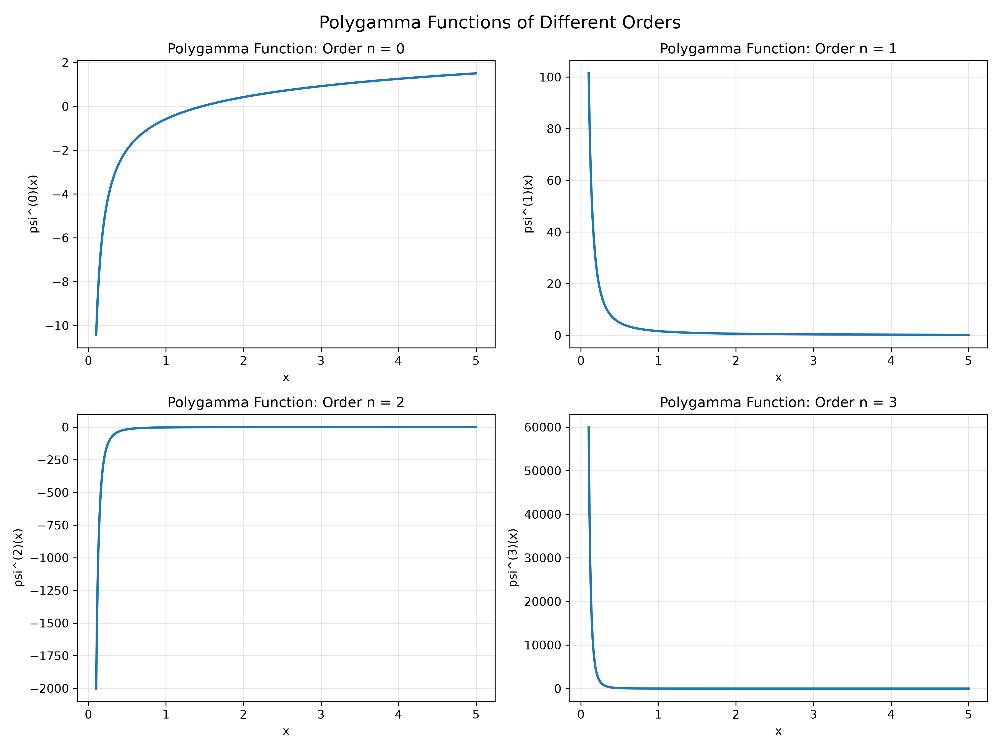
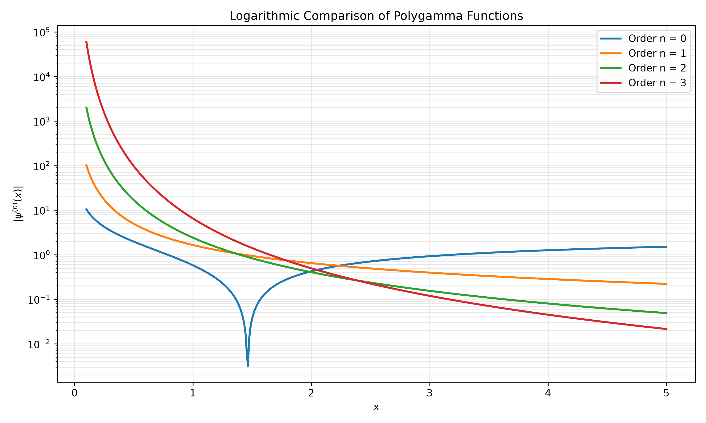

# Polygamma Function: Numerical and Graphical Study

## 1. Introduction

This project presents a numerical and graphical study of the polygamma function using Python.

The polygamma functions are the higher-order derivatives of the logarithm of the Gamma function. They play an important role in mathematical analysis, special functions, probability theory, and asymptotic analysis.

The objective is to investigate their numerical properties, recurrence relations, series representations, sign behavior, and asymptotic approximations.

## 2. Mathematical Definition

The polygamma function of order n is defined by

\[
\psi^{(n)}(x)=
\frac{d^{n+1}}{dx^{n+1}}\ln\Gamma(x),
\]

where (n=0,1,2,\ldots) and (x>0).

Special cases:

- (n=0): Digamma function.
- (n=1): Trigamma function.
- (n\geq 2): Higher-order polygamma functions.

## 3. Numerical Evaluation

The project uses SciPy's `polygamma` function to evaluate the polygamma functions for different positive arguments and orders.

The numerical implementation considers orders from zero to four and several positive values of x.

## 4. Special Values

The following identities are verified numerically:

\[
\psi(1)=-\gamma,
\]

\[
\psi\left(\frac12\right)
=-\gamma-2\ln 2,
\]

\[
\psi^{(1)}(1)=\frac{\pi^2}{6},
\]

\[
\psi^{(1)}\left(\frac12\right)
=\frac{\pi^2}{2}.
\]

The absolute errors are approximately zero, at machine precision.

## 5. Recurrence Relations

The recurrence relation is

\[
\psi^{(n)}(x+1)=
\psi^{(n)}(x)+
\frac{(-1)^n n!}{x^{n+1}}.
\]

The identity is tested numerically for orders zero through four.

The maximum absolute errors are very small, confirming the numerical accuracy of the implementation.

## 6. Series Representation

For (n\geq1) and (x>0),

\[
\psi^{(n)}(x)=
(-1)^{n+1}n!
\sum_{k=0}^{\infty}
\frac{1}{(x+k)^{n+1}}.
\]

The project approximates the infinite series using finite partial sums.

The convergence errors are investigated for different truncation levels.

The numerical experiments show that the error behaves as

\[
R_N=O(N^{-n}).
\]

Higher-order polygamma series converge more rapidly.

## 7. Sign Properties

For (n\geq1) and (x>0),

\[
(-1)^{n+1}\psi^{(n)}(x)>0.
\]

This sign property is verified numerically for orders one through five over 200 points in the interval [0.1, 10].

## 8. Graphical Visualization

The project generates two figures.

### 8.1 Polygamma Functions of Different Orders

The first figure displays the functions of orders zero, one, two, and three.



### 8.2 Logarithmic Comparison

The second figure compares the absolute values of the four functions using a logarithmic vertical scale.


`/`/`/

## 9. Asymptotic Approximation

For (n\geq1), the leading-order asymptotic approximation is

\[
\psi^{(n)}(x)\sim
\frac{(-1)^{n-1}(n-1)!}{x^n},
\qquad x\to\infty.
\]

The approximation is compared with SciPy's numerical values for different values of x and orders.

The numerical experiments show that the relative error decreases as x increases.

## 10. Technologies Used

- Python
- NumPy
- Matplotlib
- SciPy
- Math module

## 11. Project Structure

```text
polygamma_function/
|
|-- polygamma_function.py
|-- README.md
|-- polygamma_orders.png
|-- polygamma_log_comparison.png

```

## 12. How to Run

Install the required packages:

```bash
pip install numpy matplotlib scipy
```

Run the program from the repository root:

```bash
python special_functions/polygamma_function/polygamma_function.py
```

## 13. Conclusion

This project presents a numerical and graphical study of the polygamma functions. It verifies important special values and recurrence relations, investigates series representations and sign properties, and explores asymptotic behavior through numerical experiments.
